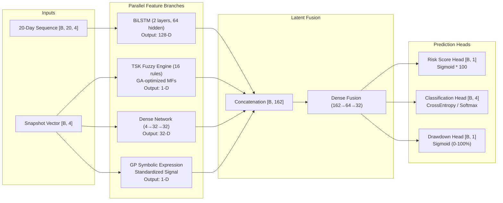

# Stock Market Risk Prediction System

A hybrid quantitative system combining **Soft Computing** (Takagi-Sugeno-Kang fuzzy inference + evolutionary optimization) with **Deep Learning** (bidirectional LSTMs) to assess equity downside risk. Supports US equities and Indian benchmark stocks (NSE).

---

## Overview

The system predicts market risk profiles rather than point prices:
- **Continuous Risk Score (0–100):** Composite metric representing market stress and downside potential.
- **Four-Class Risk Category:** Discrete regime mapping into `Low` (<25), `Moderate` (25–50), `High` (50–75), and `Extreme` (≥75).
- **10-Day Forward Maximum Drawdown:** Expected peak-to-trough decline over the next 10 trading sessions.
- **Auditable Fuzzy Explanations:** 16 Takagi-Sugeno-Kang rules with Gaussian membership functions exposing why a stock is flagged as risky.

---

## Architecture

The model processes four input metrics extracted from OHLCV data: Annualized Sharpe Ratio, Historical Maximum Drawdown, Garman-Klass Intraday Volatility, and 21-day Historical Volatility.



- **Genetic Algorithm (GA):** Globally tunes the 24 Gaussian membership function parameters ($m, \sigma$) in the TSK layer to prevent local gradient minima and degenerate memberships.
- **Genetic Programming (GP):** Discovers symbolic mathematical feature interactions from historical training splits via parsimony-pressured evolutionary search.

---

## Empirical Evaluation

Evaluated across a strictly chronological held-out test set (648 trading sessions, zero look-ahead leakage):

| Model Configuration | Risk Score MAE (0–100) | $R^2$ Score | Accuracy (%) | 10-Day MDD MAE |
|---|---|---|---|---|
| **Full Hybrid (BiLSTM + TSK + GA + GP)** | **6.19** | **0.748** | **68.98%** | **0.0283** |
| Without GA Optimization | 7.43 | 0.665 | 70.52% | 0.0329 |
| Without TSK Fuzzy Layer | 6.50 | 0.714 | 66.98% | 0.0290 |
| Without BiLSTM (Temporal ablation) | 14.02 | -0.336 | 41.82% | 0.0293 |
| Without Dense Vector Branch | 6.66 | 0.711 | 69.60% | 0.0290 |

*Findings:*
- The **BiLSTM temporal branch** provides the strongest predictive signal; removing it reduces $R^2$ to negative values.
- The **TSK Neuro-Fuzzy layer** provides full interpretability while preserving predictive performance.
- The **Genetic Algorithm** improves score MAE by 1.24 points over unoptimized membership initializations.

---

## Installation & Usage

### 1. Requirements & Setup

Requires Python 3.10+ (tested on Python 3.11, 3.12, and 3.13):

```bash
git clone https://github.com/VermaVanshdeep/Stock-Market-Risk-Prediction.git
cd Stock-Market-Risk-Prediction
python -m venv .venv
source .venv/bin/activate  # Windows: .venv\Scripts\activate
pip install -r requirements.txt
```

### 2. Interactive Dashboard

Launch the Streamlit web application:

```bash
streamlit run app.py
```

Features:
- Ticker search for US and Indian NSE stocks (`RELIANCE.NS`, `TCS.NS`, `AAPL`, etc.) with automatic currency switching (`₹` vs `$`).
- Real-time Plotly price and drawdown profiles, candlestick charts, and risk gauge dials.
- Inspection table showing the exact fuzzy rule firing percentages behind each prediction.

### 3. Test Suite

Run the automated unit and integration tests (287 tests):

```bash
pytest
```

---

## Project Structure

```
├── config/settings.py          # Feature bounds, risk thresholds, ticker mappings
├── data/                       # Ingestion loader and feature extraction
├── models/
│   ├── deep_neuro_fuzzy_net.py # 162-D hybrid neural architecture
│   ├── fuzzy_layer.py          # TSK ANFIS layer with Gaussian MFs
│   ├── genetic_optimizer.py    # 24-gene GA optimizer for fuzzy parameters
│   ├── genetic_programming.py  # Symbolic tree evolution
│   └── train.py                # Multi-task loss training and temporal splits
├── ui/                         # Streamlit presentation layer and Plotly charts
└── utils/                      # Sharpe, Drawdown, Garman-Klass IV, HV routines
```

---

## Notes & Limitations

- **Not Financial Advice:** This software is an academic research system designed for risk profiling and quantitative analysis, not trade execution.
- **Score Uncertainty:** Risk scores carry an expected test error of approximately $\pm 6$ points; predictions should be evaluated by category regime rather than absolute precision.
- **Data Dependencies:** Live quotes and historical series rely on Yahoo Finance and Google Finance feeds. Offline synthetic fallback via Merton Jump Diffusion is supported for testing US tickers, but explicitly disabled for Indian NSE listings to ensure real-market data integrity.
